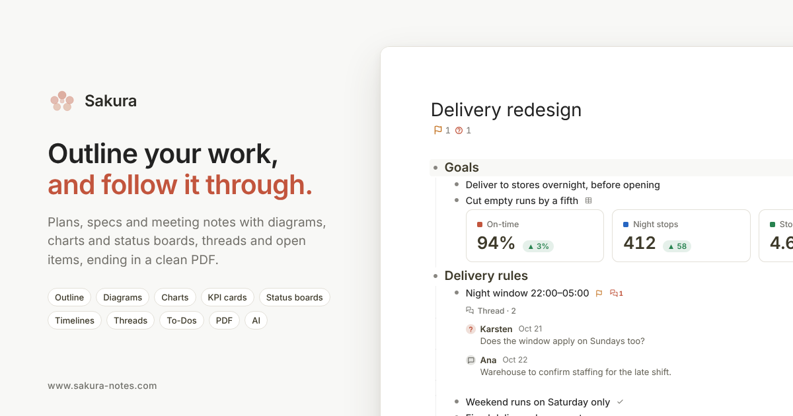

# Sakura

**Outline your work, and follow it through.**

Sakura is a web app for structured documents: plans, specs, designs, meeting notes and decisions. You write in an outline, attach the diagrams, tables and screenshots that belong to each point, discuss each point right where it sits, and keep track of what is still open until it is settled. When it's ready, you hand people a clean PDF.

Open it at **[www.sakura-notes.com](https://www.sakura-notes.com)**. There's nothing to install and no account needed. Your documents stay in your browser until you choose to sign in, and then they follow you to any device.



## Contents

- [What it's for](#what-its-for)
- [A day with Sakura](#a-day-with-sakura)
- [The outline](#the-outline)
- [Diagrams, tables and pictures](#diagrams-tables-and-pictures)
- [One table, many views](#one-table-many-views)
- [Threads: questions, follow-ups and decisions](#threads-questions-follow-ups-and-decisions)
- [To-Dos](#to-dos)
- [PDF](#pdf)
- [AI](#ai)
- [Your data](#your-data)
- [Keyboard](#keyboard)
- [Technical details](#technical-details)
- [License](#license)

## What it's for

Most work documents aren't essays. They are a set of points, each with details under it, and each with open questions, people to chase and decisions to record. Plain documents scatter all of that: the diagram sits in another tool, the discussion is in a chat thread, the open points are in a spreadsheet, and the tasks live somewhere else again.

Sakura keeps all of it on the point it belongs to:

- **The outline** gives the document its shape. Fold away the detail to see the big picture, and drag a point to move everything under it.
- **Objects on a row** hold the content that isn't text: a draw.io diagram, a table shown as a chart, KPI cards, a status board or a timeline, a marked-up screenshot, or a note.
- **A thread on a row** holds the conversation about that point, with comments, questions and answers, and decisions.
- **A status on a row** says where the point stands: Follow-up, Agreed or Out of scope.
- **Open items** collects everything still open in the document into one list you can work through, copy as an agenda or print.
- **To-Dos** hold your own tasks across all documents, each one linked back to the row it came from.
- **PDF** turns the whole thing into a document you can send, with a cover, contents, and the open items listed.

It works well for:

- **Project and solution design:** requirements, scope, architecture and integration notes, with diagrams and decision records in place.
- **Workshops and meetings:** agenda in, notes taken live under each point, questions captured as they come up, follow-ups assigned before the call ends.
- **Specs and reviews:** a draft people can comment on point by point, with a Draft, Review, Approved or Rejected status on the document.
- **Status tracking:** status boards, timelines and progress bars made from plain tables, and a list of what's still open, with how long each item has been open.
- **Personal planning:** a task list with due dates, repeats, subtasks and "waiting for", and a calm editor for thinking things through.

## A day with Sakura

> You have a design workshop at ten. Before it, you outline the agenda in Sakura, one row per topic, and paste last week's architecture diagram under the integration row.
>
> During the call you take notes under each topic as people talk. A colleague asks whether the night delivery window applies to the weekend, and nobody knows. You add it as a **question** in that row's thread with their name on it. Two points get settled: you mark one row **Agreed** and record the decision in its thread. Another needs input from the warehouse team, so you set it to **Follow-up** and press **Add to To-Dos**.
>
> After the call, the **open items** button under the title shows 1 open question and 3 follow-ups. You press **copy** and paste a dated agenda into the follow-up mail. On Friday someone answers the weekend question, so you reply to it in the thread. The question closes and the count drops.
>
> At the end of the sprint you set the document to **Review** and download the **PDF**. It has a cover page, contents, every diagram and table in place, the threads printed under their rows, and a page listing what is still open.

## The outline

- Every line is a **row**. **Enter** adds a row, **Tab** and **Shift+Tab** indent and outdent, and **Alt+↑/↓** moves a row together with everything under it. You can also drag a row onto another to nest it.
- **Fold** any branch to hide its detail. A folded row shows **+N** for its hidden rows, and the count turns your accent colour when an open question or follow-up is hidden inside.
- Rows are real rich text: bold, italic, underline, strikethrough, colour, highlight and links. Select words and a small bar appears.
- **Headings** (three levels) and **checkboxes** come from the **/** list. Type `/` at the start of a word anywhere: in a row it inserts headings, a note, table, image, diagram or thread, and everywhere it offers dates and characters.
- **@** links one row to another. The link keeps working when either row is renamed.
- **#tags** on rows. Click one to filter the document to it.
- **Zoom** into one branch to work on it alone, and use **Zen mode** (the corner button) for a full-screen page.
- **Search** (`Ctrl/Cmd+/`) finds documents, rows, notes, threads, table cells, image captions, To-Dos and settings, and runs commands like "dark mode" or "new document".
- **Version history** keeps up to 10 versions of each document, spread over time. Extra safety versions are saved before big deletions and before another device's copy replaces this one. Right-click the title to open it.
- Documents live in **folders** in the File Explorer on the left. The line at the top shows where the open document is filed.

## Diagrams, tables and pictures

Each row can hold several objects, shown directly under it:

- **Diagrams:** a full **draw.io** editor is built in. Add a diagram to a row, or drop a `.drawio`, `.drawio.svg` or `.drawio.png` file onto it. The preview zooms, steps through a row's diagrams, copies the picture, and downloads PNG or SVG (the SVG reopens in draw.io).
- **Tables:** start blank, paste a range straight from Excel or Google Sheets, or pick a ready-made shape. Each table can be shown in many ways; see [One table, many views](#one-table-many-views).
- **Pictures:** paste a screenshot or drop image files onto a row. Images are compressed automatically and shown as captioned thumbnails. **Mark up** draws rectangles, arrows, highlighter boxes and text labels on top of the picture, while the original stays untouched underneath.
- **Notes:** a few lines of supporting text under a row (`Shift+Enter`), with links and formatting.

All of it comes along when you copy, duplicate, undo, restore a version, sync or print.

## One table, many views

Type the data once as a plain table, then pick how it **shows** (right-click → Show as). Switching never changes the data, and the PDF prints the same view.

| View | Good for |
|---|---|
| **Table** | The data itself, with clean rules, typed columns (status, date, person, any currency), a heat-map, grouped rows and a total row that is always up to date |
| **Bar, stacked bar, line, pie and doughnut charts** | Comparing numbers and trends |
| **Cards** | KPIs: a big value per card with a green ▲ or red ▼ change, an icon and an accent colour |
| **Progress bars** | How far each workstream is, against 100% or its own goal |
| **Status board** | Open points in lanes (Open, In progress, Blocked, Done) with owners and due dates; late items turn red |
| **Timeline** | Milestones on a vertical or horizontal line, with the next one highlighted |
| **Pros and cons** | Two side-by-side cards, ticks and crosses, for a decision |
| **Chips** and **inline** | Short code lists, such as `ZN · Night distribution` |
| **Row cards** | Wide tables whose rows read as records |

When a view doesn't fit the data, Show as says why ("A timeline needs a date column") and offers a fix where it can, such as using another column as the date. Ready-made starters (status board, timeline, cards, progress bars, pros and cons, bar chart) open with sample rows to type over.

## Threads: questions, follow-ups and decisions

Every row can carry a **thread**: the conversation about that point, kept where the point is.

- An entry is a **comment**, a **question** or a **decision**. Replies sit indented under the entry they answer, and a reply to a question answers it.
- Entries carry an author and a date. Taking notes in a meeting, you can write an entry in someone else's name.
- An **open question** is the only coloured thing in a thread. The row's thread icon shows how many are still open.
- A row's **status** sits on the row itself: **Follow-up**, **Agreed** or **Out of scope**, with the date it was set, so you can see how old a follow-up is. **Add to To-Dos** turns a follow-up into a task linked back to the row.
- The **open items** button under the title lists every follow-up and open question in the document, each with its age. Click an item to jump to it, or **filter** the outline to only those rows. **Copy** turns the list into a dated agenda for an email. **F8** steps through the open items one by one.
- **Decisions** are listed in the same place, so "what did we decide, and why?" has one answer.
- **Copy thread** puts the whole conversation on the clipboard, ready to paste into a mail or chat.

## To-Dos

One task list for everything, separate from any document, on the rail on the left (`Ctrl/Cmd+Shift+T`).

- Sections: **Pinned**, **Today** (due today or overdue), **Upcoming**, **Anytime** and **Waiting**. Finished tasks fold into **Done**.
- Each task has a due date, a repeat (daily, weekdays or weekly) or subtasks, a pin, and **waiting for**: who or what you're waiting on, and since when.
- A task can **link** to a document, a row or a web address. Tasks made from a follow-up say where they came from.
- Titles are written for real work items: long text, formatting and links all work.
- On a phone, Sakura opens a dedicated To-Dos page that you can add to your home screen. On Android, you can share a link or text from another app straight into a new task.

## PDF

**Share → Download PDF** turns the document into something you can send:

- A **cover page** with the title, author, status stamp (Draft, Review, Approved, Rejected) and your own mark, such as a team name.
- A **contents** page with page numbers that you can click in the saved PDF.
- Every row, note, table (shown the way it shows in the app), chart, diagram and marked-up picture in place. A table that runs over a page break repeats its header row.
- **Threads** printed under their rows, with replies indented.
- An optional **open items** page listing every follow-up and open question, each with the page it's on.
- Rows you mark **Leave out of export** stay out, so internal notes never reach the reader.

The To-Dos list exports to PDF too, and documents also export to OPML.

## AI

AI is optional. You can turn it off entirely, and nothing is sent anywhere until you use it.

- **Rewrite** a row, selected words, a note, a thread entry or a task. It corrects grammar and spelling and keeps your formatting. The instruction it follows is editable in Settings.
- **Auto-rewrite** (off by default) tidies rows a short while after you finish them, in one batched request. While it's on, "✦ Auto-rewrite on" shows quietly at the bottom right.
- **Generate outline** (`Ctrl/Cmd+Shift+O`) turns a topic into a starting outline.

Two ways to run it:

- **Sakura Hosted AI:** sign in and it just works, with no key to find. Each account gets a daily quota.
- **Bring your own key:** Gemini, Groq, OpenRouter and GitHub Models have free tiers, Cerebras depends on the account, and Claude and ChatGPT need a paid account. Your text goes straight from your browser to that provider. You can set a fallback order for when one provider fails.

## Your data

- **No account needed.** Everything is stored in your browser and works offline once loaded. Sakura can also be installed as an app from the browser's address bar.
- **Sign in** (Google or email) to sync documents, folders, To-Dos and settings across your devices.
- **Send a copy** of a document to another Sakura user. It becomes their own document; nothing stays linked.
- **Backup** saves everything to one file, and **Restore** brings it back (with one-step undo).
- **Secure storage** locks your AI keys with a passphrase.
- **No analytics or tracking.** Crash reports are off unless you turn them on, and never include your content.

Settings → About → Privacy & data in the app explains exactly what goes where.

## Security

What Sakura protects, and where the limits are:

- **Your documents are yours.** The database rules let only your own account read or write your documents, folders, To-Dos and settings. A copy you send can be read only by the person you sent it to, and nobody can change it after it is sent.
- **Your AI keys can be locked.** Secure storage encrypts them in your browser with a passphrase only you know (AES-256, key derived with PBKDF2). Without the passphrase they cannot be read.
- **The page talks only to known hosts.** A Content-Security-Policy allowlist limits where the app can send requests, and there are no analytics or trackers.
- **Hosted AI keys never reach the browser.** They live in the server that forwards your request, and each account has a daily quota.
- **Not end-to-end encrypted.** Synced documents are encrypted at rest by Google Cloud, but the service can technically read them. Text you send to AI goes to the AI provider you chose (and through Sakura's server for Hosted AI). For anything that must stay strictly private, stay signed out and leave AI off: then your documents never leave your browser.

## Keyboard

| Action | Keys |
|---|---|
| New row / new child / note under the row | Enter / Ctrl/Cmd+Enter / Shift+Enter |
| Indent / outdent | Tab / Shift+Tab |
| Move row up or down | Alt+↑ / Alt+↓ |
| Insert list (headings, objects, characters) | / at the start of a word |
| Link selected words, otherwise Search | Ctrl/Cmd+K |
| Search and commands | Ctrl/Cmd+/ |
| Bold / italic / underline / strikethrough | Ctrl/Cmd+B / I / U / Shift+S |
| Heading 1–3 / body text | Ctrl/Cmd+Alt+1–3 / Ctrl/Cmd+Alt+0 |
| Zoom into a branch / back out | Ctrl/Cmd+. / Ctrl/Cmd+, |
| Next / previous open item | F8 / Shift+F8 |
| Find / find and replace in the document | Ctrl/Cmd+F / Ctrl/Cmd+H |
| To-Dos | Ctrl/Cmd+Shift+T |
| Generate outline | Ctrl/Cmd+Shift+O |
| Zen mode | Ctrl/Cmd+Shift+E |
| Back / forward between documents | Ctrl/Cmd+[ / Ctrl/Cmd+] |
| New document | Ctrl/Cmd+Alt+N |
| Undo / redo | Ctrl/Cmd+Z / Ctrl/Cmd+Y |

You can change any shortcut in Settings → General → Keyboard shortcuts. Help → Cheatsheet lists the rest.

## Technical details

**What runs where**

- The app is two static pages: `index.html` (the full editor) and `hub.html` (the phone To-Dos page). They are built with Vite and served by GitHub Pages at `www.sakura-notes.com`. There is no application server: the editor, the PDF renderer, diagram editing and storage all run in the browser.
- **Storage:** browser `localStorage`, with a service worker for offline use and installing as an app (PWA).
- **Accounts and sync:** Firebase Authentication (Google, email) and Cloud Firestore, one document per item under `users/{uid}`, newer copy wins. Access rules are in `firebase/firestore.rules`.
- **Hosted AI:** a Cloudflare Worker (`worker/`) holds the provider keys, enforces the daily quota per account and tries the providers in order. Bring-your-own-key requests go straight from the browser to the provider. A Content-Security-Policy allowlist limits which hosts the page can talk to.
- **Diagrams:** the draw.io editor (diagrams.net, Apache 2.0) runs embedded in a frame.
- **PDF:** the document is laid out as print HTML and printed through the browser's own print dialog.

**Repository layout**

```
web/            the app
  index.html    the editor page (markup, styles and script)
  hub.html      the phone To-Dos page
  src/          typed, tested logic and the CSS, spliced into the pages at build time
  tests/        unit tests (Vitest) and end-to-end tests (Playwright)
  public/       icons, manifests, service worker, social card
worker/         Cloudflare Worker for Sakura Hosted AI
firebase/       Firestore security rules
docs/           feature reference, design notes and the session handoff
```

`web/src` holds the logic that moved out of the pages into TypeScript modules with tests. `npm run generate -w sakura-web` copies it, and the CSS in `web/src/styles`, back into the pages between `GENERATED` markers. Edit the files in `src/`, never the copies in the HTML. `docs/history/architecture-plan.md` explains how this works.

**Develop**

```
npm ci
sh scripts/setup-git-identity.sh   # once per clone: commit identity and pre-commit guard
npm run dev -w sakura-web          # local server
```

Run these before every pull request (CI runs them too):

```
npm run typecheck -w sakura-web
npm run lint -w sakura-web
npm run test:unit -w sakura-web
npm run generate:verify -w sakura-web
npm run build -w sakura-web
npm run test:e2e -w sakura-web
```

Every merge to `main` is built and published by `.github/workflows/deploy.yml`. The Worker deploys with `deploy-worker.yml`.

**More documentation**

- [docs/feature-reference.md](docs/feature-reference.md): every behaviour, key and menu in detail.
- [docs/ai-hosted-vault-design.md](docs/ai-hosted-vault-design.md): the design of the hosted AI and key vault.
- [docs/handoff-prompt.md](docs/handoff-prompt.md): the working rules and current state, for anyone (or any AI session) picking up the work.

## License

All rights reserved. See [LICENSE](LICENSE). The repository is public so the code can be read, which doesn't grant permission to reuse or redistribute it.

Sakura embeds draw.io (diagrams.net, Apache 2.0) for diagram editing. See [THIRD-PARTY-NOTICES.md](THIRD-PARTY-NOTICES.md).
